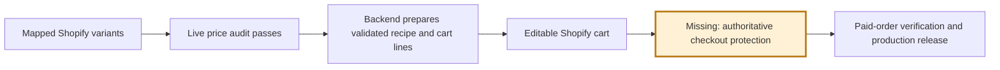

# Checkout options while keeping Shopify Basic

## Current connection

Verified September 16 in the installed Shopify app: mapping revision 2; all five rows pass Shopify price/status/grouping checks. USD: Standard 1–2 herbs 29.99, Strong 1–2 herbs 33.99, Standard 3–4 herbs 34.99, Strong 3–4 herbs 38.99, premium 4.00 per premium herb per jar. These are provisional prices, not client approval. This audit does not check stock or checkout.

Backend cart preparation is already deployed. It validates recipes, checks current Shopify prices and saves the recipe reference. Local cart validation also compares a shopper's cart with saved recipes. Neither prevents a shopper from bypassing the storefront and visiting checkout directly. A digest identifies recipe content; it is not a signature.

## Options

| Route | Verified support | What still needs proof |
| --- | --- | --- |
| SMART Functions Creator | Vendor says free on live stores; includes validation rules. No merchant-written code execution. | Authenticating backend recipe approvals; dynamic per-build premium ratios; stale approval rejection. Not established by reviewed docs. |
| Function Studio | Checkout validation; Standard currently $25/month, Advanced $49/month with metafields/JSON attributes. Free tier is development/staging only. | Same trust and per-build checks. Vendor explicitly says no real-time external-system validation. Presence of a recipe property is insufficient. |
| Backend-created draft order | Shopify API can create draft line items and return a secure checkout/invoice link. Requires write_draft_orders permission. | Prototype with existing variants; tampering/quantity behavior; expiry and repeat checkout; taxes, shipping, discount policy, stock reservation and paid-order association. Changes the normal cart flow. Not yet implemented. |
| Own public Functions app | Public apps with Functions can work on Basic. | Shopify distribution/review work and ongoing app obligations. Not an immediate shortcut for a single custom app. |

**Recommendation:** keep Basic. A public app is the least disruptive only if it can prove the recipe trust checks. A draft-order proof of concept is the alternative to investigate before considering Plus. Do not call either route production-ready based on documentation alone.

## Concrete acceptance example

Two jars with two premium herbs each require two jar units and four premium units. Checkout must reject removed premium units, changed jar variants, forged recipe references and stale approvals. A different blend cannot borrow those premium units. Invalid requests must not create a production ticket. Verify direct and accelerated checkout paths, duplicate submissions and recovery by removing invalid lines.

For draft orders, trust the server-held draft/order association, not customer-editable notes. Check that only eligible draft checkouts can become production jobs. Keep public generic custom-jar purchasing disabled if it bypasses the controlled purchase flow. Shopify inventory reservations do not reserve ERP herbs; those require the future ERP integration.

## Evidence and next step

- [Shopify Functions availability](https://shopify.dev/docs/apps/build/functions)
- [Shopify checkout validation](https://shopify.dev/docs/apps/build/checkout/cart-checkout-validation)
- [SMART Functions Creator limitations](https://functions-creator.com/docs/what-functions-creator-does-not-do)
- [Function Studio pricing](https://apps.shopify.com/easylogic-functions-studio)
- [Function Studio validation limitations](https://function-studio.app/docs/fail-validation/)
- [Shopify draftOrderCreate and required permission](https://shopify.dev/docs/api/admin-graphql/latest/mutations/draftOrderCreate)
- [Shopify draft orders and invoices](https://help.shopify.com/en/manual/fulfillment/managing-orders/create-orders)

No app was installed, subscription started, permission expanded, price approved or customer message sent. Formulation and price approvals remain launch gates; engineering can proceed using explicit test cases.

## Correction: existing draft experiment found

The September 15 work in **Healistix implementation continuation** already tested draft checkout. Its saved results supersede the earlier statement here that a first prototype still needs starting.

- Five local payload tests passed.
- Real unpaid Shopify draft #D1 opened checkout: two custom jars at $46.99 each = $93.98, with premium costs included; no separate premium line or observed quantity/removal control.
- The custom item had no jar image and no catalog inventory association. Shipping and payment were not tested.
- Draft-order scope was already approved and installed via app version commerce-draft-checkout. Do not request it again merely to repeat this preparation; verify current access when using the API.
- Next: test API creation with the actual jar variant and price override, then connect the existing builder. Preserve saved quote/order association and verify stock, shipping, payment and production handoff.

[Existing experiment and detailed results](C:/Users/chhet/Documents/Codex/2026-09-15/healistix-checkout-options/RESULTS.md)

[Existing unpaid draft #D1](https://admin.shopify.com/store/b5895f-96/draft_orders/1277272719498)
