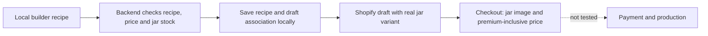

# Builder → real Shopify draft checkout

## Verified September 16

- Previously granted `write_draft_orders` permission works. No additional permission or app purchase.
- API experiment #D2 uses the real Strong 3–4 herb jar variant. Its catalog price remains $38.99; the draft price is $46.99 including two premium herbs. Two jars total $93.98.
- The local builder created #D3 from its displayed, revalidated recipe. Browser checkout shows the real jar image, herb grams, flavor, strength, quantity two and $93.98 subtotal. No separate premium line or visible line editing control.
- Repeating the builder button returned the same #D3 rather than creating another draft. The existing draft link survives page reload and server restart through the local manifest journal.
- Jar stock is checked before creation. ERP herb stock is **not** checked or reserved. The former premium SKU is a fee representation and is not consumed by this test; it is not evidence of herb availability.
- No contact/address/payment details entered, invoice email sent, payment made, inventory adjustment or production dispatch.

## Try the result

[Local connected builder](http://127.0.0.1:8799). The top banner links to the existing #D3. Use that link to inspect the checkout without creating another draft. The sample button loads the tested recipe into the actual builder UI; recipe edits use the existing engine.

This is a loopback-only integration prototype. The published theme, app proxy and hosted customer purchase path were not changed.

## Implementation

Worktree: `C:/Users/chhet/Desktop/healistix-theme/output/admin-erp-release`.

- `app/services/draft-checkout-plan.server.ts`: revalidation, current Shopify price/status audit, jar stock check, privacy-safe attributes and premium-inclusive price.
- `scripts/draft-checkout-review.ts` and `scripts/draft-review-ui/`: local service and builder extension. Existing theme assets are served from the theme project.
- `tests/draft-checkout-plan.test.ts`: premium packing, price drift, stock shortage, invalid recipe/quantity and sensitive-field exclusion.
- Local journal: `C:/Users/chhet/Desktop/healistix-theme/output/draft-review-journal`. Validated recipe/quote, Shopify draft and request hash; no raw quiz answers or credentials. Do not publish checkout links or journal files.

Restart from that worktree: `node --import tsx scripts/draft-checkout-review.ts`. It binds to 127.0.0.1:8799, requires the exact local Host/Origin for writes, limits body size and caps the review to three journalled attempts. It loads the already approved `.env.devstore` from the September 15 cart-release worktree. Never copy that file into source control. If the Shopify session expires, open the installed Composio app to refresh it, then retry the same attempt.

The journal records an exclusive attempt before Shopify creation. Unknown or mismatched results stop for reconciliation; they are not blindly retried. This is local review behavior, not a distributed production idempotency implementation.

## Remaining before public release

Persist quotes in the production database; authenticate and limit draft creation; reconcile uncertain responses; expire/cancel abandoned drafts; restrict the old ordinary-cart purchase path; bind Shopify paid orders to the stored quote; verify amounts, currency and lines; reserve ERP herbs/capacity; test shipping/taxes, discounts, inventory changes, cancellation and accelerated payment. Formulations and prices remain provisional. No assertion of comprehensive checkout tamper resistance or production readiness follows from this unpaid test.

Previous experiment: [September 15 results](C:/Users/chhet/Documents/Codex/2026-09-15/healistix-checkout-options/RESULTS.md).

Validation: TypeScript check passed; all 7 focused draft/cart tests passed. Builder-created draft is #D3 (1277408706698).

## Hosted update

This prototype is now deployed to the unpublished Custom Builder Review theme. See [deployment and verification record](unpublished-draft-checkout-deployment-2026-09-16.md). Start a session from Composio's Draft checkout review screen; localhost is no longer required for this flow.
