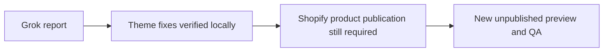

# Grok QA follow-up — September 17, 2026

Source: user-supplied `C:/Users/chhet/Downloads/REPORT.md`, tested against an earlier Shopify preview. Its observations were treated as evidence, not authorization to change Shopify administration. This follow-up changes the local theme only; no live product, order, discount or publication changes.

| Finding | Current result | Evidence and boundary |
|---|---|---|
| L1 Custom purchase | **Theme paths fixed; launch blocker remains** | The shared paused-product helper previously covered wellness products only. It now also covers Custom Sea Moss Gel and its Premium herb add-on when custom blends are disabled. Custom PDP renders coming-soon content, with no purchase form. Catalog and search cards use the same guard. Browser verified custom PDP and search have no custom purchase link/form. |
| L2 Broken Shop links | **Fixed locally** | Both desktop and mobile links for Super Tonics, Super Bitters and Beef Tallow now render only when the named collection exists and has products. Browser desktop Shop shows Sea Moss only. Code is retained for future collections. |
| L3 Welcome offer | **Paused locally** | Offer UI/assets render only when a new default-off “Enable verified welcome offer” section setting is enabled AND a discount code is configured. Homepage DOM has no lucky signup component. The report did not test email submission or discount redemption, so a broken discount itself is unproven. |
| M1 Cart close clipping | **Fixed and verified** | Drawer sizing is explicit, mobile wrapper fills viewport, close stays inside padded panel. At 375px, occupied-cart close bounds are x313–357, 44px wide. At 390px, empty-cart close bounds are x328–372, 44px wide. |
| M2 Drawer right strip | **Fixed and verified** | Root scroll lock removes residual document scrollbar. Floating header backdrop filters created a containing block that offset the menu; disable those filters only while menu is open and anchor menu to viewport. Menu bounds x0–375 / x0–390, bottom812 /844 at tested sizes. Temporary viewport reset afterward. |
| M3 Missing plan in drawer | **Fixed and verified** | Existing broad CSS hid the saved plan paragraph. Dedicated selling-plan class now stays visible. Added one Banana monthly subscription through the PDP: drawer showed Monthly Subscription and $22.50. Removed that test line afterward; cart returned empty. No checkout/order created. |
| M4 Previous-flavor flash | **Loading-state guard added** | Main photo and headline stay hidden behind a loading message until the requested image is ready. Browser observed loading state then correct Ashwagandha Mango hero; settled Mango/Unflavored/Blueberry assets match selection. Network-throttled stress testing was not performed. |

## Required Shopify administration before release

The theme is storefront presentation, not a commerce authorization layer. **Custom Sea Moss Gel can remain purchasable through Shopify direct cart/API routes until its product publication/status is changed in Shopify.** Set the custom product and custom-only add-on to an appropriate non-selling state (such as Draft) or remove availability from every selling channel that must be paused. Verify the actual channel and cart/checkout behavior afterward, including existing cart lines. No such change was performed here.

Search/catalog counts still come from Shopify's published index before theme filtering. Browser `search?q=custom&type=product` shows “2 results” with no custom cards; catalog previously reported 5 products while rendering fewer cards. Correct product publication is the durable fix, and avoids misleading client-side total rewrites across pagination. Do not mark L1 fully closed based on hidden theme cards.

## Merchant confirmations and stale findings

- Free shipping over $30 requires rate/checkout confirmation with the merchant's actual shipping setup.
- Current gift UI explicitly says “OFFER PREVIEW” and “Concept only. Gifts are not currently included at checkout.” This differs from treating the old report's reward observation as a current fulfillment promise. It is still a launch decision whether to keep preview content.
- Review count/source, launch flavor stock choices, label approvals and final ingredient copy remain merchant decisions; this pass does not certify them.
- Re-enable welcome offer only after configured discount matches the advertised percentage/free-shipping terms and is verified in checkout. No email signup or personal information submitted in this pass.
- New preview must be refreshed from this branch before Grok retests; prior report is not proof these local fixes are deployed.

## Local checks

Popup schema JSON parsed successfully. `git diff --check` passed. Browser checked custom route, desktop links, custom search, homepage offer absence, subscription add/remove, empty and occupied cart bounds, and mobile menu bounds at 375×812 and 390×844. Root agent runs consolidated Shopify Theme Check with integration work. Files and features remain reversible; no branch switch or commit performed by this agent.

Consolidated Theme Check completed: no errors in changed Liquid files. Existing layout/header warnings remain (preloads, remote assets, hardcoded collection routes); the broader theme still has pre-existing findings. Root reviewed the diffs and committed theme fixes separately from new gallery work.
