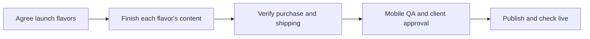

# Regular sea moss PDP — launch gaps and Git checkpoints

Reviewed September 17, 2026 against local source, the running Shopify development preview, product JSON and rendered subscription allocations. This is a readiness review, not a completed launch acceptance test.

## Git safety

Both repositories now use `codex/base-flavor-pdp`.

| Repository | Earlier-work checkpoint | Isolated custom pause |
|---|---|---|
| Theme | `09e1753` | `7bdc4c6` |
| Backend | `8192a62` | `a729e18` |

Earlier-work checkpoints also have branch `codex/checkpoint-before-base-pdp`. Original theme `main` remains at `3b71ad3`; original backend `codex/recipe-engine-migration` remains at `f85f60f`. No history rewrite, reset, push or publication occurred. The staging index was used to reconstruct the pre-pause content; working source bytes were verified unchanged against backups.

Local source backups and commit manifests: `staging/git-safety-2026-09-17/`. Existing `output/` and `tmp/` material remains on disk, outside these commits, including nested release worktrees. Credentials, dependency folders and generated build caches were not added. Theme tracked source is clean; output/tmp remain intentionally untracked. Backend is clean. These are local checkpoints, not an off-device backup.

## Smallest regular-product launch path

## What already exists

- Regular product page, flavor selection, quantity controls and a native Shopify product form.
- Gallery, label drawers and interactive jars where source artwork supports them.
- Single-flavor and mixed-flavor cart integration; earlier reports record actual cart additions and drawer checks.
- Subscription selector reading actual Shopify selling-plan allocations.
- Reviews, product information, Banana story sections, shared use/preparation content and mobile layout work.
- Reversible custom-blend storefront pause, verified locally. Backend pause source has two passing tests and a passing TypeScript check; hosted deployment remains pending.

## Remaining work

| Priority | Deliverable | Current evidence and exact remaining boundary |
|---|---|---|
| Before launch | Agree which base flavors are launching; confirm sellable stock and prices | Product JSON currently has 23 variants at $25 each. Eight are marked available: Banana, Blueberry, Mango, Rose, Peach, Orange, Unflavored and Strawberry. Fifteen are unavailable. Shopify availability is not a physical stock audit. The catalog also includes botanical blends; decide which belong in this regular-product release. |
| Before launch | Correct per-flavor photos, labels and product facts | Banana has the richest story; Blueberry has dedicated editorial imagery; other supported flavors use jar artwork and shared content. Rose and Orange lack supplied artwork despite being marked available. Existing artwork notes flag Strawberry 17 oz front versus 16 oz sides, and Beet Root right-label ingredient mismatch. Confirm or exclude affected flavors. These documented label issues were not independently resolved by this review. Every launch flavor needs correct image, ingredients, size, serving and storage information; elaborate campaign imagery for every flavor can follow later. |
| Before launch | Remove preview offers or make them real | The spoon at three jars and bowl/spoon at five are explicitly concept-only. No gift cart lines or checkout fulfillment are implemented. Hide the offer for a simpler launch, or implement real inventory, eligibility and fulfillment before promising gifts. |
| Before launch if subscriptions remain visible | Verify subscription checkout and customer management | Fresh rendered data now has plan allocations for all 23 variants at $22.50. Earlier documentation saying zero allocations is outdated. Verify the selected plan survives single and mixed cart changes, shows the correct recurring interval/price in checkout, and has working customer cancellation/management. If not ready, launch one-time purchase first. No new payment or subscription was created during this review. |
| Before launch | Complete the regular order journey | Verify each enabled launch flavor, stock failures, quantity edits, removal, single/mixed carts, shipping threshold/rates, taxes and payment availability; complete an authorized test order through confirmation and merchant fulfillment visibility. Existing cart checks do not prove paid checkout. Confirm delivery areas, dispatch/storage promises and shipping policy with the client. |
| Before launch | Approve customer-facing copy and review presentation | Reconcile label facts with current packaging. Have the client approve origin, taste, nutrition and serving copy; the current PDP still says “THE BEST-TASTING SEA MOSS.” Verify review count/source attribution and link behavior rather than carrying forward an unverified aggregate. This review does not certify claims or labels. |
| Before launch | Final mobile and desktop acceptance | Existing mobile checks cover multiple widths, but repeat focused checks on the final release: flavor image/price/label switching, sold-out controls, drawer, sticky Add to cart, subscriptions if enabled, missing images, keyboard access and loading on a phone. No full 23-variant acceptance pass was completed here. |
| Release | Publish approved theme and verify live | Local development preview is not the published store. Push an unpublished release theme, have the client review it, then publish the approved version and check the actual customer journey. Deploy the separate backend purchase pause if the hosted custom endpoints must be paused too. Previously issued draft invoice links require separate handling; the new server gate does not revoke them. |

## Polish that can follow a working purchase journey

- Matching editorial story sections for more flavors.
- Checkout branding refinements, subject to Shopify checkout settings.
- Gift rewards, if omitted from the first release.
- Custom blends, their production workflow and related ERP work are separate from finishing this regular Shopify PDP.

## Recommended next small milestone

Agree the launch-flavor list, then audit those flavors one by one against their actual jar labels and photos. In parallel with that decision, the next implementation task can hide the gift preview without deleting it. Do not change inventory, subscription plans or published content merely to make the page appear ready.
