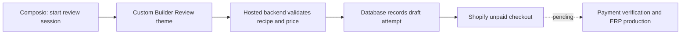

# Unpublished draft checkout deployment - September 16, 2026

## Deployed

- Target theme: Custom Builder Review, 158342054026, unpublished.
- Files: assets/hx-builder-app.js, assets/hx-builder-draft-review.js, sections/hx-builder.liquid.
- Backend: f648b60da412a001bf20eadd9117ea0ad16f7898, Render deployment dep-dal4is7avr4c7393qmq0, Live.
- Source: output/admin-erp-release isolated backend worktree; merged hosted changes back into the sibling backend without replacing unrelated local work.

## Try it

[Open Composio Draft checkout review](https://admin.shopify.com/store/b5895f-96/apps/composio-623/app/draft-review), choose Start review session, then Open Custom Builder Review.

[Browse the unpublished builder](https://healistix.com/?preview_theme_id=158342054026&view=builder-review). Draft creation requires the session link from Composio. Sessions last one hour, maximum three draft attempts. Reloading clears the in-page token; reopen the session link. Existing invoices remain open after session expiry. Do not pay review invoices.

## Evidence

- 63 backend tests passed; two optional PostgreSQL tests skipped; TypeScript and production build passed.
- Hosted admin grant creation proves the new migration tables are available.
- Synthetic Calm/Focus strong recipe with Korean red ginseng, lemon balm and lion's mane created one Shopify jar line at $42.99, including its $4 premium.
- Repeating the button returned exactly the same hosted invoice URL and the UI reported the existing draft was reopened.
- Recipe editing rejected an over-limit powder addition and retained the valid blend.
- A quantity input issue found in the hosted test was corrected to handle input events and clear stale checkout links immediately.
- No payment, contact/address entry, invoice email or production dispatch.

## Still pending

Formulation and price approval, ERP herbs/capacity reservations, paid-order processing, abandoned invoice cancellation and shipping/tax acceptance tests. This is an unpaid review flow, not a public launch.
- Final hosted quantity check passed: two Standard 3-4 herb jars at $34.99 each appeared in Shopify checkout with subtotal $69.98. Shipping remained uncalculated because no address was entered.
- Final draft-review module also rejects zero/invalid quantities instead of falling back to one.

## Hosted draft records

Composio confirmed both records as Ready to inspect: 1277412638858 (premium test, one jar at $42.99) and 1277413130378 (quantity test, two jars at $69.98). Their private invoice links are available in the authenticated admin screen.
